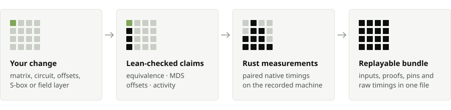
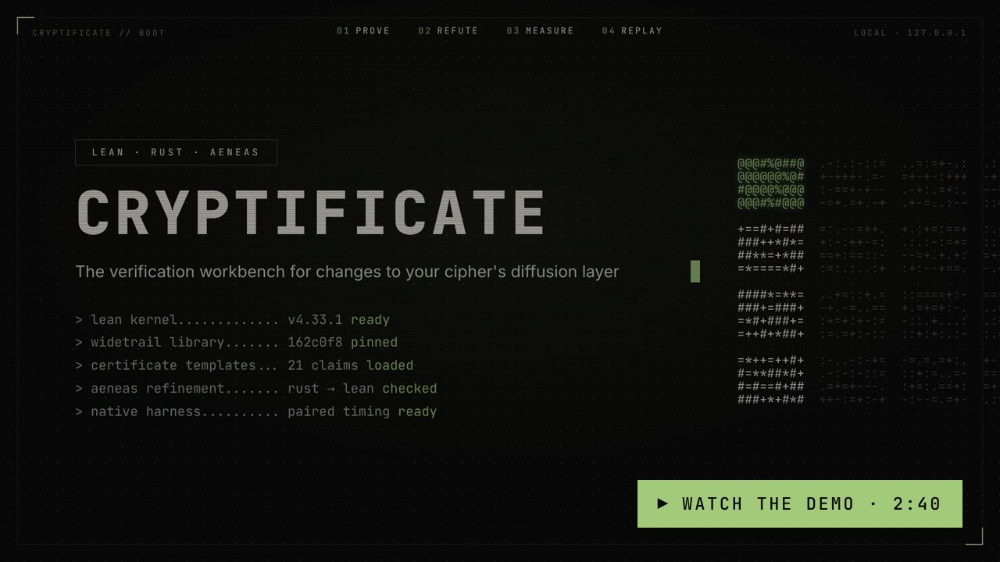

<div align="center">

<picture>
  <source media="(prefers-color-scheme: dark)" srcset="assets/brand/logo-dark.png">
  
</picture>

### The verification workbench for changes to your cipher's diffusion layer

You change a cipher component: the MixColumns matrix, the circuit that computes it, the row offsets, the S-box, or the linear layer of a Poseidon2-style permutation. Cryptificate proves in Lean whether your circuit computes the matrix for every input, proves which diffusion guarantees your design keeps, and shows the exact input wherever one fails. It then measures your native Rust code against the original and packs all of it into one bundle that anyone can re-check.

**[Start](#start-in-one-step)** · **[Who it is for](#who-it-is-for)** · **[How you use it](#how-you-use-it)** · **[Demo](#demo)** · **[Install](#install)** · **[What it proves](#what-it-proves)** · **[Why you can trust a result](#why-you-can-trust-a-result)** · **[Rust source to model](#from-rust-source-to-the-model)** · **[Architecture](#architecture)**

[](lean/lean-toolchain)
[](lean/lakefile.toml)
[](docs/evidence-model.md#proof-acceptance)
[](refinement/STATUS.md)
[](https://github.com/4waan/Cryptificate/actions/workflows/checks.yml)
[](LICENSE)



</div>

## Start in one step

**In your browser, with nothing to install:** open the guided story at **[4waan.github.io/Cryptificate](https://4waan.github.io/Cryptificate/)** and click through the four steps.

**On your own machine:**

```sh
git clone https://github.com/4waan/Cryptificate && cd Cryptificate && npm start
```

`npm start` installs anything missing on the first run (the pinned Lean toolchain, the Mathlib cache, the Rust engine and the workbench), starts the local service and opens the workbench at `http://127.0.0.1:4173`. Every later `npm start` opens it in seconds. Then pick a step of the guided story, or open **Workspace**, type a matrix and press **Check design and circuit**.

**In your own repository**, once the checkout above is set up:

```sh
alias cryptificate="node $PWD/apps/server/dist/src/cli.js"   # in the Cryptificate checkout
cd ~/src/my-cipher && cryptificate init    # asks for the model, a starting design and the policy
cryptificate doctor                        # lists anything missing, with the command that fixes it
cryptificate check                         # applies cryptificate.json
```

`init` writes `cryptificate.json` (inputs, policy and claim scope), a starting design under `cryptificate/designs/` and `.github/workflows/cryptificate.yml`, which runs the same check on pull requests with the [GitHub Action](docs/ci.md) and uploads the result to code scanning. It never overwrites a file without `--force`; `--yes` (or no terminal) takes the defaults, and `--model`, `--preset`, `--circuit`, `--fail-on` and `--ci` answer the questions from the command line.

## Who it is for

| You are | You use Cryptificate to |
|---|---|
| **A cipher designer** choosing a new MDS matrix, new row offsets or a new S-box for an AES-like or Poseidon2-like construction | get a Lean proof of the branch number, the offset dispersion and the active-S-box lower bound for your exact numbers, or a checked input that breaks them |
| **An implementer** writing a cheaper circuit for MixColumns or a Poseidon2 linear layer | prove your circuit computes the matrix on every input, then time it against the reference under a paired statistical protocol |
| **A reviewer or auditor** looking at someone else's change | read one report that keeps design guarantees and implementation correctness apart, and replay its proofs on your own machine |

## How you use it

1. **Describe the change.** Edit the matrix, offsets, rounds, S-box and circuit in the workbench, or write them as JSON. Bytes are two hex digits; elements of a prime field (BN254, BabyBear, KoalaBear, Mersenne31, Goldilocks or your own prime below 2⁶⁴) are decimal strings. Start from a preset (AES MixColumns and InvMixColumns, circulants, Poseidon2 t = 3, deliberately weak controls), paste a matrix straight from C, Rust, Python or Sage, or generate a term-by-term circuit from the matrix. The workspace is saved in your browser, every edit can be undone, and **Copy share link** puts the design and circuit in a URL; opening someone's link keeps your own edits so you can restore them.
2. **Check it.** Cryptificate generates a Lean certificate for your exact values and checks it. A fresh 4×4 MDS certificate takes about three seconds. While you edit, the workbench shows quick browser diagnostics labelled *Preview (not yet checked by Lean)* until the Lean result arrives; switch on **Auto-check** to have every pause in editing checked, or press <kbd>Ctrl</kbd>/<kbd>⌘</kbd>+<kbd>Enter</kbd>. <kbd>Ctrl</kbd>/<kbd>⌘</kbd>+<kbd>K</kbd> opens a command palette and <kbd>?</kbd> lists the shortcuts.
3. **Read the evidence.** The report shows two chains side by side: *design guarantees* (MDS, offsets, S-box, activity bound, S-box differential uniformity and linearity) and *implementation correspondence* (circuit equivalence, Rust-source refinement, native correctness, timing). Every refutation comes with concrete bytes you can check by hand.
4. **Search and measure.** A bounded search proposes cheaper circuits. Each candidate is proved equivalent in Lean and run against 9,214 test inputs before it is timed against the textbook circuit and the direct implementation.
5. **Share it.** Download the evidence bundle. `cryptificate verify` regenerates the design and circuit claims from the bundle's inputs with the installed checker.

## Demo

[](https://youtu.be/aPrDzEGmKto)

**[Watch the demo on YouTube (2:40)](https://youtu.be/aPrDzEGmKto)** ([MP4 in the repository](docs/media/cryptificate-demo.mp4)): the wrong wire, the weak matrix, the prime field, the circuit search with native timing, a fresh design checked live, and a bundle replayed with `cryptificate verify`.

The workbench opens on a guided story of four real experiments. Each button loads real inputs, and every result on screen comes from Lean and the native harness.

| Step | What you do | What Cryptificate proves |
|---|---|---|
| **1. Beat the reference** | Start from AES MixColumns and its textbook circuit (4 xtime, 15 XOR) and run a quick search | A 12-XOR circuit, proved equivalent in Lean and correct on 9,214 native inputs, with paired timings against both baselines |
| **2. One wire goes wrong** | Change the first output's `xtime(a ⊕ b)` to `xtime(a ⊕ c)` after guessing which output breaks | A Lean-checked witness: input `[00,01,00,00]` must give `[03,02,01,01]`; the changed circuit gives `[01,02,01,01]` |
| **3. Perfect implementation, weak diffusion** | Replace both the matrix and the circuit with the identity | Circuit equivalence holds, and the design check catches the weak matrix: `[01,00,00,00]` has 1 + 1 = 2 nonzero bytes, below the branch number 5 |
| **4. Prime field** | Poseidon2's width-3 matrix over BN254 with a shared-sum circuit, S-box exponent 5, then 3 | Equivalence and MDS for the BN254 layer; `x⁵` certified bijective by an inverse exponent; `x³` caught by a checked collision between 1 and a cube root of unity |

Open the guided story online: **[4waan.github.io/Cryptificate](https://4waan.github.io/Cryptificate/)**.

## Install

Linux with 8 GB of RAM is enough. You need git, curl, a C toolchain, Rust stable, Node 20+ and Python 3.10+ (for the repository's scripts; the client package in [`python/`](python) declares 3.9+).

```sh
git clone https://github.com/4waan/Cryptificate && cd Cryptificate
npm start                   # first run: pinned Lean toolchain, Mathlib cache, engine, workbench
```

`npm start` runs `scripts/setup.sh` when something is missing and then `npx cryptificate serve`; both can also be run on their own.

From the terminal:

```sh
npx cryptificate check examples/designs/aes-row-scaled.json
npx cryptificate check examples/designs/aes.json --program examples/programs/aes-wrong-wire.json
npx cryptificate check examples/designs/poseidon2-bypass.json
npx cryptificate check examples/designs/koalabear-t4.json
npx cryptificate experiment examples/designs/aes.json --program examples/programs/aes-known-shared-sum.json --profile quick
npx cryptificate verify examples/bundles/aes-wrong-wire/aes-wrong-wire.tar.gz
```

From Python, with the standard library only:

```python
from cryptificate import Client, aes_like_design, aes_shared_sum_program

client = Client("http://127.0.0.1:4173")
job = client.analyze(aes_like_design(rounds=10), program=aes_shared_sum_program())
final = client.wait(job["id"])
for claim in final["report"]["claims"]:
    print(claim["id"], claim["status"], claim["evidence"]["label"])
client.bundle(job["id"], "evidence.tar.gz")
```

Over HTTP, from any language: the service's API is described in [docs/api.md](docs/api.md) and, machine-readably, in [`schemas/openapi.json`](schemas/openapi.json) (OpenAPI 3.1, also served at `GET /api/openapi.json`).

The [adopter guide](docs/adopter-guide.md) walks through a first design end to end.

### With Docker

The [`Dockerfile`](Dockerfile) builds one image with the pinned Lean toolchain, the built certificate library and Mathlib's compiled library, the engine, the Rust toolchain for native experiments and the workbench. Version tags publish it to `ghcr.io/4waan/cryptificate` (`linux/amd64`, over 10 GB unpacked); `docker build -t cryptificate .` builds it from a checkout.

```sh
# the workbench at http://127.0.0.1:4173 (the service binds loopback unless told otherwise)
docker run --rm -p 127.0.0.1:4173:4173 ghcr.io/4waan/cryptificate serve --host 0.0.0.0

# one-shot check of a design file in the current directory
docker run --rm -v "$PWD:/work" ghcr.io/4waan/cryptificate check my-design.json

# re-check a bundle
docker run --rm -v "$PWD:/work:ro" ghcr.io/4waan/cryptificate verify examples/bundles/aes-wrong-wire/aes-wrong-wire.tar.gz
```

`--host 0.0.0.0` is needed because a published port does not reach the container's loopback interface; `-p 127.0.0.1:…` keeps the port on your machine's loopback, since the service has no authentication. The image does not check the Rust-source refinement proofs, so `rust.refinement` reads `not_established` there for GF(2^8) circuits (`unsupported` for BN254 circuits, which no refinement proof covers). Details, port and permission rules and limits: [docs/docker.md](docs/docker.md).

## What it proves

| Claim | How Cryptificate establishes it | Example from the demo |
|---|---|---|
| The circuit computes `M` on every input | One interpretation theorem proved once for all circuits, then a comparison of 16 coefficients | the crossed wire, refuted on `[00,01,00,00]` |
| `M` is MDS, branch number 5 | All 69 square minors written as explicit determinant formulas, against a coverage theorem proved once for every 4×4 matrix | the row-scaled AES matrix `[04,06,02,02]…`, certified fresh |
| The row offsets disperse every column | Offsets checked distinct, through WideTrail's characterization of diffusion-optimal rotations | `[0,1,1,3]` caught: rows 1 and 2 share offset 1 |
| Active S-boxes over `r` rounds | For any injective S-box and any round keys, two different inputs differ at no fewer than `⌊r/4⌋·25 + (5 if r mod 4 ≥ 2)` S-box inputs | 25 for 4 rounds, 55 for 10, 200 for 32 |
| The S-box is a permutation | An inverse table for byte S-boxes, an inverse exponent for power maps over BN254 or `ZMod p` | `x³` over BN254 caught by a collision |
| Exact differential uniformity and linearity of a byte S-box | The kernel tests every row of the difference table and every Walsh coefficient of the submitted table, packed into one number, against the value, and recounts a witness that attains it; a property of the table, not a trail bound | AES: 4 and 32 (nonlinearity 112); AES with two entries swapped: 6 and 32 |
| The modulus is prime (prime-field profile) | A Pratt certificate for your modulus, computed by the engine and checked by kernel evaluation (`Pratt.prime_of_checkFlat`); every other claim uses the field it gives | Goldilocks `2⁶⁴ - 2³² + 1`, where trial division is out of reach |
| HADES outer rounds | WideTrail's outer-round bound for your external and internal matrices, branch number width + 1 | 16 active S-boxes over 8 full rounds at width 3, 20 at width 4 |
| Wide Poseidon2 layers (widths 8 to 24) | The engine computes inverse matrices modulo `p`; the kernel checks `M · M⁻¹ = 1` with each row and column packed into one number, so every entry is one big-number product (`Packed.checkInverse`). The same check certifies the rows `eᵢ Mʲ` behind a window of `L = t` partial rounds, and one packed comparison shows that the external matrix is `circ(2 M₄, M₄, …, M₄)` with `M₄` MDS. That matrix is not MDS: a singular `2 × 2` submatrix refutes it, and no full-round bound is stated | Plonky3's BabyBear, KoalaBear and Mersenne31 width 16 and 24 and Goldilocks width 8 and 12: both matrices invertible; KoalaBear-16 and Goldilocks charge every window of `t` partial rounds; with fewer partial rounds than the width (BabyBear 13 < 16) a difference passes them all |
| HADES partial rounds | As many rows `eᵢ Mʲ` of the internal matrix's powers at the partial-round S-box positions as the width, with a nonzero determinant: every `L` consecutive partial rounds activate an S-box, for any round constants. Otherwise a nonzero difference `v` with `Mʲ v` zero there for every `j` below the number of partial rounds passes all of them with no active S-box: checked through an invariant subspace, or directly on the first powers when there are fewer partial rounds than the width needs. A design with no partial rounds gets neither (out of scope) | the pinned internal matrix: `L = 3` (determinant 1), so at least 16 + ⌊56/3⌋ = 34 active S-boxes over all 64 rounds; the external matrix reused as internal matrix: `[0, 1, -1]` bypasses all 56 partial rounds |
| The round constants are the Grain constants (HADES, `constants.grain`) | The kernel runs a transcription of the Poseidon2 reference procedure (`poseidon2_rust_params.sage` of HorizenLabs/poseidon2, commit `055bde3`): the 80-bit Grain LFSR seeded from the field, S-box type, bit length of `p`, width and round numbers, 160 discarded clocks, the self-shrinking generator and rejection of candidates `≥ p`, in the Poseidon2 layout (one constant per partial round, padded with zeros), and compares the result with your constants. Otherwise it checks one position where they differ (the first one, as located by the engine) and the value the procedure generates there. This is provenance, not security: it says the constants come from the reference procedure, and nothing about how good they are | WideTrail's pinned BN254 constants are proved to be the Grain constants of `t = 3`, `R_F = 8`, `R_P = 56`; one KoalaBear constant changed from `245687908` to `245687909` is refuted at round 4, position 0 |
| The Rust source computes the model | Charon and Aeneas translate the Rust kernels to Lean, where they are proved equal to the model | GF(2⁸) arithmetic and the full AES-like round, for every design |
| The generated Rust is correct | 9,214 test inputs per GF(2⁸) variant (8,278 for BN254) before any timing | a fast but wrong circuit is kept off the leaderboard |
| It is faster on your machine | 15 paired rounds per workload, 95% bootstrap intervals, two fresh confirmation sessions | ratios with intervals for every candidate and baseline |

Which of these claims a design gets depends on its profile:

| Profile | Fields | Widths | Claims |
|---|---|---|---|
| AES-like | GF(2⁸), `0x11B` | 4 (2 and 3 experimental, not certified) | MDS, offsets, S-box, activity bound, S-box differential uniformity and linearity; circuits, search, native timing; Rust refinement |
| HADES, `hades/bn254/v1` | BN254 scalar field | 3 | external MDS, internal invertibility, power map, full-round, partial-round and total activity, Grain round constants; circuits, search, native timing |
| HADES, `hades/prime/v1` | BabyBear, KoalaBear, Mersenne31, Goldilocks, or a custom prime below 2⁶⁴ | 2, 3, 4, 8, 12, 16 and 24 | primality of the modulus, then the same design claims as over BN254 up to width 4. Above width 4: `external.mds` (refuted by a small singular submatrix, else not established), `external.m4_mds` (the Poseidon2 block structure with `M₄` MDS), `external.invertible`, internal invertibility, the power map, `activity.partial` and the Grain round constants; the full-round and total activity bounds are not established, because they need an MDS external matrix. No circuits, search, native timing or Rust refinement over these fields |

The modulus is part of every claim's meaning: a matrix can be MDS modulo one prime and not another, and `x³` permutes KoalaBear but not BabyBear. The example designs [`koalabear-t4.json`](examples/designs/koalabear-t4.json) (`x³`) and [`babybear-t4.json`](examples/designs/babybear-t4.json) (`x⁷`) use Poseidon2's `M4` as external matrix with an illustrative internal matrix and round counts; they are not deployed instances. [`babybear-t4-bad.json`](examples/designs/babybear-t4-bad.json) is deliberately wrong: `x³` collides over BabyBear, and its internal matrix lets `[0, 1, −1, 0]` pass all 13 partial rounds.

The wide examples are deployed instances: [`babybear-t16.json`](examples/designs/babybear-t16.json), `babybear-t24`, `koalabear-t16`, `koalabear-t24`, `mersenne31-t16`, `mersenne31-t24`, `goldilocks-t8` and `goldilocks-t12` take the internal diagonal, round numbers and S-box exponent of Plonky3's Poseidon2 at commit [`0d803737`](https://github.com/Plonky3/Plonky3/tree/0d803737b681774186cd283b1fd2d8e493655c82) (`<field>/src/poseidon2.rs`) and its external matrix `circ(2 M₄, M₄, …, M₄)` (`poseidon2/src/external.rs`); they give no round constants, so `constants.grain` is not established for them until constants are imported (below). Lean proves for each that both matrices are invertible and that `M₄` is MDS, and refutes the MDS property of the full external matrix. KoalaBear-16 and both Goldilocks instances charge every window of `t` partial rounds from the single partial-round S-box. The BabyBear and Mersenne31 instances and KoalaBear-24 have fewer partial rounds than the width (13, 14, 21, 22 and 23), so a nonzero difference passes all of them with no active S-box; that is a statement about the partial rounds alone, which is expected whenever there are fewer of them than the width, and says nothing about the full rounds. The same holds for the custom-modulus example [`prime-t12.json`](examples/designs/prime-t12.json) (8 partial rounds at width 12): expect `activity.partial` to be refuted for any design with fewer partial rounds than its width. The full-round bound is not established for any of these widths: it needs an MDS external matrix, and no theorem here bounds the activity of full rounds through `circ(2 M₄, M₄, …, M₄)`.

Claim `constants.grain` compares explicit round constants (and, over BN254, the profile's reference constants) with the Poseidon2 reference procedure for the design's modulus, width and round numbers; a design that gives no constants gets it as not established. `npx cryptificate import FILE --base DESIGN.json` puts constants from a Plonky3 source file (`…_EXTERNAL_INITIAL`, `…_INTERNAL`, `…_EXTERNAL_FINAL`), a HorizenLabs poseidon2 instance (`RC3`, `RC16`, …) or printed list, JSON or CSV into a copy of a design, in the Poseidon2 layout; this works at every width of the profiles, including Plonky3's wide instances (Plonky3's KoalaBear width-16 constants imported into `koalabear-t16.json` are proved to be the Grain constants). The model's faithfulness to the reference scripts is the trusted part: it reproduces WideTrail's pinned BN254 constants in the kernel and published BabyBear, KoalaBear and Goldilocks constants in tests, and is not derived from a formal semantics of the scripts. Poseidon (version 1) lays out its constants differently, `t` per partial round, and is not covered.

Every report labels its origin: **Live**, **Cached exact result**, or **Recorded run** (replayed from a recorded bundle without a running service; nothing was checked now). Editing any input marks earlier results as belonging to an earlier version until you check again. The full vocabulary of statuses and evidence labels is in [docs/evidence-model.md](docs/evidence-model.md).

## Why you can trust a result

**The Lean kernel checks every claim.** A certificate is generated from fixed [templates](lean/templates) with your numbers substituted in. The service accepts a theorem only when:

1. its name and printed type match the expected statement about your exact constants;
2. Lean's own evaluation of those constants equals your normalized request, so the proof is about the numbers you submitted;
3. the audit command re-checks the theorem and its local dependencies in the kernel, and its axioms are among the standard three: `propext`, `Classical.choice`, `Quot.sound`.

**The hard mathematics is proved once.** Each certificate only evaluates bytes in the kernel with `decide`: the coefficient theorem, the minor-coverage theorem and the execution bridge are general results. Certificates use the kernel alone, without `native_decide` or `bv_decide`, which would extend trust to the whole compiler ([Lean reference: axioms](https://lean-lang.org/doc/reference/latest/Axioms/)).

**It is fast enough to use while you work.**

| Certificate (one thread, whole file) | Time |
|---|---|
| AES shared-sum circuit, equivalence | 3.2 s |
| Wrong-wire circuit, checked witness | 3.1 s |
| 256-instruction circuit with heavy sharing | 4.4–8.5 s |
| MDS, offsets and activity bound for a fresh matrix | 3.3–8.5 s |
| HADES: external MDS, internal invertibility, exponent, full-round activity | 3.9–4.4 s |
| HADES with the partial rounds: window certificate and whole-permutation bound, or a bypass | 3.9–4.8 s |
| HADES over BabyBear, KoalaBear, Mersenne31, Goldilocks or a custom prime, width 2, 3 or 4: primality and every design claim | 3.2–5.8 s |
| Differential uniformity and linearity of a submitted byte table | 10.5–11.5 s |
| Poseidon2 widths 8 to 24 (Plonky3 instances): primality, inverse witnesses of both matrices, `M₄`, the low-weight refutation and the partial rounds | 4.4–6.8 s |
| HADES with explicit round constants: the Grain procedure run in the kernel (KoalaBear `t = 4`, 52 constants; BN254 `t = 3`, 80 constants of 254 bits, 192 layout entries) | 3.9–6.4 s |
| Plonky3 KoalaBear width 16 with its imported round constants: the wide-width claims and the Grain procedure (148 constants) | 5.8 s (one run) |

**Every push re-checks everything.** [CI](https://github.com/4waan/Cryptificate/actions/workflows/checks.yml) rebuilds the Lean library, runs every certificate example, re-checks the refinement proofs on Lean 4.35, runs the Rust, Node and Python test suites, and runs the GitHub Action on example designs, one of which must fail the gate.

## From Rust source to the model

The native code Cryptificate measures is built on [`crates/kernels`](crates/kernels). Its GF(2⁸) arithmetic and its AES-like round are translated to Lean by [Charon and Aeneas](https://github.com/AeneasVerif/aeneas) and proved equal to the mathematical model, so for GF(2⁸) designs the field operations the timed code calls are, at the source level, the ones in the proofs.

| Rust | Lean theorem, for all inputs and with no panic | Connected to |
|---|---|---|
| `gf256::mul` | `gf256.mul a b = ok ⟨GF256.rawMul a.bv b.bv⟩` | WideTrail's field `GF256` |
| `gf256::xtime`, `gf256::add` | equal to `GF256.xtime` and to XOR | WideTrail's field `GF256` |
| `aes_like::round`, `aes_like::encrypt` | equal to `aesLikeRound` and `aesLikeExec` of [`Bridge.lean`](lean/Cryptificate/Bridge.lean) for every matrix, offsets, S-box table and key schedule (`encrypt` given at least `rounds` keys) | the active-S-box bound, assuming an MDS matrix, distinct offsets and an injective S-box table |
| `aes_like::encrypt` with the AES matrix, offsets `[0, 1, 2, 3]` and the FIPS 197 S-box as byte arrays | for any two different inputs and any round keys (at least `r`), the executions return normally and have at least `activityBound r` active S-boxes: `≥ 55` over 10 rounds, `≥ 25` over 4; no design hypothesis, the design checks are evaluated by the Lean kernel | the active-S-box bound, for AES rounds without the special last round |
| `aes_like::final_round`, `aes_like::encrypt_with_last_round` | equal to `aesLikeFinalRound` (no column mixing, then a final key) and `aesLikeCipher` (`r - 1` rounds, then that final round) of [`Bridge.lean`](lean/Cryptificate/Bridge.lean), for every design and key schedule (given at least `rounds + 1` keys) | the same bound over the `r` rounds, the final round's S-boxes included, under the same three assumptions |
| `aes_like::encrypt_with_last_round` with the AES byte arrays | for any two different inputs and any round keys (at least `r + 1`), the executions return normally, the outputs are the model's AES-like cipher with WideTrail's AES S-box, and its `r` rounds have at least `activityBound r` active S-boxes: `≥ 55` for the ten rounds of AES-128; no design hypothesis | the active-S-box bound for the AES data path with its final round, for every key sequence; the AES key expansion is not modelled (the Rust tests check the FIPS 197 ciphertexts) |
| gf256 crate 0.3.1 (`0x11B`, table-free), expanded source | its `mul` equals WideTrail's multiplier, assuming `size_of::<u8>() = 1` | WideTrail's field `GF256` |
| `bn254_mont::{mul, add, sub, to_mont, from_mont}` (BN254 Montgomery form on `[u64; 4]`) | on canonical inputs, no panic and the canonical result of `a·b·R⁻¹`, `a + b`, `a − b` mod p (and `x·R`, `x·R⁻¹` for any input) | WideTrail's `Poseidon2.BN254.F = ZMod p`, through `toField x = x·R⁻¹` |

Because the round kernel takes the design as runtime data, one proof covers every AES-like design you submit. For a concrete design, `aes_like_encrypt_activity_bound_of_checks` (and its final-round form) replaces the three design hypotheses by Boolean checks on its bytes; the AES rows are those theorems with the checks evaluated, and the service does not yet run them for submitted designs. The BN254 kernel is proved, but the native BN254 variants still call arkworks' `Fr`, which Aeneas cannot translate, so the timed BN254 arithmetic is not covered ([STATUS.md, section 4](refinement/STATUS.md)). The extraction script reproduces the Lean translation byte for byte from the pinned source; pins and hashes are in [refinement/](refinement/STATUS.md).

## Search and measurement

The search builds a primitive circuit from polynomial-basis multiples, extracts shared pairs, factors `xtime(a) ⊕ xtime(b) = xtime(a ⊕ b)`, cancels repeated XORs, hash-conses and removes dead code, with tie choices driven by fixed seeds. For AES MixColumns it finds a 12-XOR, 4-xtime circuit, three XORs fewer than the textbook circuit.

Every compared variant uses the same arithmetic, compiler and flags, is built as its own shared library, and is timed by one harness over 4 KiB, 64 KiB and 1 MiB workloads: samples of at least 50 ms, 3 warmups, 15 paired rounds in randomized order, 95% paired bootstrap intervals over 10,000 resamples, then two confirmation sessions with fresh seeds. A speed-up is reported as **locally confirmed** when the interval's lower bound clears 1.02 in both sessions against every baseline. On the BN254 internal layer `[[2,1,1],[1,2,1],[1,1,3]]` the searched circuit replaces three multiplications with additions and runs about 7.2× faster than the direct implementation on the 64 KiB primary workload (about 3.1× at 1 MiB), with the lowest 95% lower bound at 7.05 across both confirmation sessions ([raw data](examples/measurements/bn254-internal)). On AES the compiler already vectorizes every variant, and the harness shows the three circuits within each other's intervals.

The measurement ABI, `mix_batch(input, output, column_count)`, is plain C, so an implementation in any language can join the comparison: see [docs/batch-interface.md](docs/batch-interface.md).

## Re-check a bundle

```sh
npx cryptificate verify examples/bundles/aes-wrong-wire/aes-wrong-wire.tar.gz
```

`verify` reads the bundle's inputs and claims, regenerates the certificate with the installed generator, checks it with the installed Lean toolchain and prints a claim-by-claim comparison. It runs no code from the bundle. Timings stay attached to the machine that produced them. The [recorded bundles](examples/bundles) from the demo are in the repository.

For an audit or a pull request, `npx cryptificate report <bundle> --format html --output report.html` writes one printable HTML file with the inputs and their digest, both claim chains with the exact Lean statements and axioms, counterexamples, timing intervals and provenance; it runs no scripts and loads nothing from the network. New bundles carry it as `report.html`, and the workbench's **Export report** button downloads a live run's `report.html` from the local service, or renders a recorded run's page in the browser with the same renderer ([details](docs/ci.md#html-evidence-report)).

## Use it in CI

`cryptificate check` gates a pull request on the claims of your design and circuit files. It takes several files or patterns, applies a policy with `--fail-on refuted|not-established|any` and exits 0 when the policy holds, 1 when it fails and 2 when an input could not be checked, including when Lean or the engine is missing. Results come out as text, JSON, SARIF 2.1.0, JUnit XML, Markdown or a self-contained HTML evidence report, and the Markdown goes to the GitHub job summary.

```yaml
- uses: actions/checkout@v4
- uses: 4waan/Cryptificate@main
  with:
    inputs: designs/*.json
    fail-on: refuted
```

`cryptificate init` writes such a workflow, with the inputs, the policy and the claim scope kept in `cryptificate.json`; `cryptificate check` and the action read that file when they are given no inputs. The action at the repository root installs the pinned Lean toolchain, fetches the Mathlib cache, builds the engine and the command, runs the check, uploads the SARIF log to code scanning, where each refuted claim points at its line in your file and carries its counterexample, and uploads one evidence bundle per input as an artifact. The options, the policy scope and the exit codes are in [docs/ci.md](docs/ci.md).

## Architecture

```text
 workbench (React)        CLI, Python client
        │  same-origin HTTP        │
        ▼                          ▼
 ┌──────────────────────────────────────────┐
 │ apps/server: loopback service, one heavy │
 │ worker, proof acceptance, bundles        │
 └──────┬──────────────┬──────────────┬─────┘
        ▼              ▼              ▼
 cryptificate-engine   lean/          crates/native
 validate, diagnose,   certificates   codegen, correctness,
 emit, search          on WideTrail   paired timing
```

| Path | What it holds |
|---|---|
| [`lean/`](lean) | Circuit semantics, canonical-minor MDS certificates, counterexample lemmas, offsets, the execution bridge, S-box and exponent certificates, Pratt primality certificates, HADES full-round bounds at widths 2 to 4 and partial-round certificates at every profile width, packed inverse-witness checks for the Poseidon2 widths 2 to 24, the Grain round-constant generator, the audit command and the certificate templates |
| [`refinement/`](refinement) | Charon/Aeneas translations of `crates/kernels` and the gf256 crate, with their Lean proofs |
| [`crates/`](crates) | `core` (validation, diagnostics, certificate emission), `cli` (`cryptificate-engine`), `search`, `native` (code generation and timing harness), `kernels` |
| [`apps/server`](apps/server) | [HTTP API](docs/api.md), job queue, proof acceptance, bundles and the `cryptificate` CLI |
| [`apps/web`](apps/web) | The workbench, also published online |
| [`python/`](python) | Python client |
| [`examples/`](examples) | Designs, circuits, evidence bundles and measurements |
| [`docs/`](docs) | [Evidence model](docs/evidence-model.md), [architecture](docs/architecture.md), [batch interface](docs/batch-interface.md), [HTTP API](docs/api.md), [adopter guide](docs/adopter-guide.md), [CI](docs/ci.md), [container image](docs/docker.md), [research directions](docs/research-directions.md) |

## Built on WideTrail

Cryptificate uses the [WideTrail](https://github.com/4waan/Wide-Trail-formal-verification) Lean library as its mathematical foundation: `GF(2⁸)` built from scratch, the MDS branch theorem, diffusion-optimal row offsets, trail activity bounds, HADES outer-round bounds and the Poseidon2 BN254 instance. WideTrail is pinned as a Lake dependency.

Cryptificate turns those theorems into a tool for arbitrary inputs: certificates for any matrix you submit, checked counterexamples, the bridge from real AES-like executions to trail bounds, universal circuit equivalence, S-box and exponent certificates, proof acceptance bound to your exact request, the circuit search, the native measurement harness, Rust-source refinement, the workbench and replayable bundles.

<details>
<summary><strong>Terms used above</strong></summary>

| Term | Meaning |
|---|---|
| **MixColumns** | The AES step that multiplies each 4-byte column by a fixed 4×4 matrix over GF(2⁸). |
| **GF(2⁸)** | Bytes with XOR as addition and polynomial multiplication modulo `x⁸ + x⁴ + x³ + x + 1` (`0x11B`). |
| **xtime** | Multiplication by the byte `02`: shift left, then XOR `1B` if the top bit fell off. |
| **Branch number** | The fewest nonzero bytes, across input and output together, of any nonzero input. AES MixColumns reaches the maximum, 5. |
| **MDS** | A matrix whose every square submatrix is invertible, which is exactly what gives the maximum branch number. |
| **Row offsets** | How far each state row rotates (AES: 0, 1, 2, 3). Distinct offsets spread each column across all four columns. |
| **Active S-box** | An S-box whose input differs between two executions. |
| **BN254, HADES, Poseidon2** | A 254-bit prime field used in zero-knowledge proofs, and the full/partial round structure of the Poseidon2 permutation over it. |
| **BabyBear, KoalaBear, Mersenne31, Goldilocks** | The 31-bit and 64-bit prime fields of zkVMs such as Plonky3, SP1, RISC Zero and OpenVM: `15·2²⁷+1`, `127·2²⁴+1`, `2³¹−1` and `2⁶⁴−2³²+1`. |
| **Pratt certificate** | A proof that `p` is prime: the factorization of `p − 1` and a number of order `p − 1` modulo `p`, with the same for each large factor. |
| **Lean, Aeneas** | A proof assistant whose small kernel checks every proof step, and a tool that translates Rust into Lean. |

</details>

## License

MIT. See [LICENSE](LICENSE).
