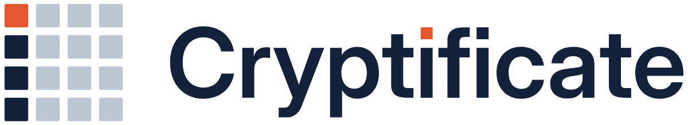
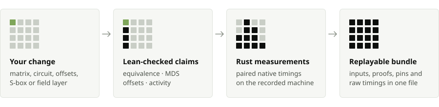

<div align="center">

<picture>
  <source media="(prefers-color-scheme: dark)" srcset="assets/brand/logo-dark.png">
  
</picture>

### The verification workbench for changes to your cipher's diffusion layer

You change a cipher component: the MixColumns matrix, the circuit that computes it, the row offsets, the S-box, or the linear layer of a Poseidon2-style permutation. Cryptificate proves in Lean whether your circuit computes the matrix for every input, proves which diffusion guarantees your design keeps, and shows the exact input wherever one fails. It then measures your native Rust code against the original and packs all of it into one bundle that anyone can re-check.

**[Who it is for](#who-it-is-for)** · **[How you use it](#how-you-use-it)** · **[Demo](#demo)** · **[Install](#install)** · **[What it proves](#what-it-proves)** · **[Why you can trust a result](#why-you-can-trust-a-result)** · **[Rust source to model](#from-rust-source-to-the-model)** · **[Architecture](#architecture)**

[](lean/lean-toolchain)
[](lean/lakefile.toml)
[](docs/evidence-model.md#proof-acceptance)
[](refinement/STATUS.md)
[](https://github.com/4waan/Cryptificate/actions/workflows/checks.yml)
[](LICENSE)



</div>

## Who it is for

| You are | You use Cryptificate to |
|---|---|
| **A cipher designer** choosing a new MDS matrix, new row offsets or a new S-box for an AES-like or Poseidon2-like construction | get a Lean proof of the branch number, the offset dispersion and the active-S-box lower bound for your exact numbers, or a checked input that breaks them |
| **An implementer** writing a cheaper circuit for MixColumns or a Poseidon2 linear layer | prove your circuit computes the matrix on every input, then time it against the reference under a paired statistical protocol |
| **A reviewer or auditor** looking at someone else's change | read one report that keeps design guarantees and implementation correctness apart, and replay its proofs on your own machine |

## How you use it

1. **Describe the change.** Edit the matrix, offsets, rounds, S-box and circuit in the workbench, or write them as JSON. Bytes are two hex digits; BN254 field elements are decimal strings.
2. **Check it.** Cryptificate generates a Lean certificate for your exact values and checks it. A fresh 4×4 MDS certificate takes about three seconds.
3. **Read the evidence.** The report shows two chains side by side: *design guarantees* (MDS, offsets, S-box, activity bound) and *implementation correspondence* (circuit equivalence, Rust-source refinement, native correctness, timing). Every refutation comes with concrete bytes you can check by hand.
4. **Search and measure.** A bounded search proposes cheaper circuits. Each candidate is proved equivalent in Lean and run against 9,214 recorded inputs before it is timed against the textbook circuit and the direct implementation.
5. **Share it.** Download the evidence bundle. `cryptificate verify` regenerates every claim from the bundle's inputs with the installed checker.

## Demo

<!-- demo-video -->

The workbench opens on a guided story of four real experiments. Each button loads real inputs, and every result on screen comes from Lean and the native harness.

| Step | What you do | What Cryptificate proves |
|---|---|---|
| **1. Beat the reference** | Start from AES MixColumns and its textbook circuit (4 xtime, 15 XOR) and run a quick search | A 12-XOR circuit, proved equivalent in Lean and correct on 9,214 native inputs, with paired timings against both baselines |
| **2. One wire goes wrong** | Change the first output's `xtime(a ⊕ b)` to `xtime(a ⊕ c)` after guessing which output breaks | A Lean-checked witness: input `[00,01,00,00]` must give `[03,02,01,01]`; the changed circuit gives `[01,02,01,01]` |
| **3. Perfect implementation, weak diffusion** | Replace both the matrix and the circuit with the identity | Circuit equivalence holds, and the design check catches the weak matrix: `[01,00,00,00]` has 1 + 1 = 2 nonzero bytes, below the branch number 5 |
| **4. Prime field** | Poseidon2's width-3 matrix over BN254 with a shared-sum circuit, S-box exponent 5, then 3 | Equivalence and MDS for the BN254 layer; `x⁵` certified bijective by an inverse exponent; `x³` caught by a checked collision between 1 and a cube root of unity |

The same story runs from recorded bundles on the [replay site](https://4waan.github.io/Cryptificate/).

## Install

Linux with 8 GB of RAM is enough. You need git, curl, a C toolchain, Rust stable, Node 20+ and Python 3.10+.

```sh
git clone https://github.com/4waan/Cryptificate && cd Cryptificate
scripts/setup.sh            # pinned Lean toolchain, Mathlib cache, engine, workbench
npx cryptificate serve      # http://127.0.0.1:4173
```

From the terminal:

```sh
npx cryptificate check examples/designs/aes-row-scaled.json
npx cryptificate check examples/designs/aes.json --program examples/programs/aes-wrong-wire.json
npx cryptificate experiment examples/designs/aes.json --program examples/programs/aes-known-shared-sum.json --profile quick
npx cryptificate verify examples/bundles/aes-wrong-wire/aes-wrong-wire.tar.gz
```

From Python, with the standard library only:

```python
from cryptificate import Client, aes_like_design, aes_shared_sum_program

client = Client("http://127.0.0.1:4173")
job = client.analyze(aes_like_design(rounds=10), program=aes_shared_sum_program())
final = client.wait(job["id"])
for claim in final["report"]["claims"]:
    print(claim["id"], claim["status"], claim["evidence"]["label"])
client.bundle(job["id"], "evidence.tar.gz")
```

The [adopter guide](docs/adopter-guide.md) walks through a first design end to end.

## What it proves

| Claim | How Cryptificate establishes it | Example from the demo |
|---|---|---|
| The circuit computes `M` on every input | One interpretation theorem proved once for all circuits, then a comparison of 16 coefficients | the crossed wire, refuted on `[00,01,00,00]` |
| `M` is MDS, branch number 5 | All 69 square minors written as explicit determinant formulas, against a coverage theorem proved once for every 4×4 matrix | the row-scaled AES matrix `[04,06,02,02]…`, certified fresh |
| The row offsets disperse every column | Offsets checked distinct, through WideTrail's characterization of diffusion-optimal rotations | `[0,1,1,3]` caught: rows 1 and 2 share offset 1 |
| Active S-boxes over `r` rounds | For any injective S-box and any round keys, two different inputs differ at no fewer than `⌊r/4⌋·25 + (5 if r mod 4 ≥ 2)` S-box inputs | 25 for 4 rounds, 55 for 10, 200 for 32 |
| The S-box is a permutation | An inverse table for byte S-boxes, an inverse exponent for BN254 power maps | `x³` over BN254 caught by a collision |
| HADES outer rounds | WideTrail's outer-round bound for your external and internal matrices | 16 active S-boxes over 8 full rounds |
| The Rust source computes the model | Charon and Aeneas translate the Rust kernels to Lean, where they are proved equal to the model | GF(2⁸) arithmetic and the full AES-like round, for every design |
| The generated Rust is correct | 9,214 recorded inputs per GF(2⁸) variant (8,278 for BN254) before any timing | a fast but wrong circuit is kept off the leaderboard |
| It is faster on your machine | 15 paired rounds per workload, 95% bootstrap intervals, two fresh confirmation sessions | ratios with intervals for every candidate and baseline |

Every report labels its origin: **Live**, **Cached exact result** or **Recorded run**. Editing any input marks earlier results as belonging to an earlier version until you check again. The full vocabulary of statuses and evidence labels is in [docs/evidence-model.md](docs/evidence-model.md).

## Why you can trust a result

**The Lean kernel checks every claim.** A certificate is generated from fixed [templates](lean/templates) with your numbers substituted in. The service accepts a theorem only when:

1. its name and printed type match the expected statement about your exact constants;
2. Lean's own evaluation of those constants equals your normalized request, so the proof is about the numbers you submitted;
3. the audit command re-checks the theorem and its local dependencies in the kernel, and its axioms are exactly the standard three: `propext`, `Classical.choice`, `Quot.sound`.

**The hard mathematics is proved once.** Each certificate only evaluates bytes in the kernel with `decide`: the coefficient theorem, the minor-coverage theorem and the execution bridge are general results. Certificates use the kernel alone, without `native_decide` or `bv_decide`, which would extend trust to the whole compiler ([Lean reference: axioms](https://lean-lang.org/doc/reference/latest/Axioms/)).

**It is fast enough to use while you work.**

| Certificate (one thread, whole file) | Time |
|---|---|
| AES shared-sum circuit, equivalence | 3.2 s |
| Wrong-wire circuit, checked witness | 3.1 s |
| 256-instruction circuit with heavy sharing | 4.4–8.5 s |
| MDS, offsets and activity bound for a fresh matrix | 3.3–8.5 s |
| HADES: external MDS, internal invertibility, exponent, activity | 3.9–4.4 s |

**Every push re-checks everything.** [CI](https://github.com/4waan/Cryptificate/actions/workflows/checks.yml) rebuilds the Lean library, runs every certificate example, re-checks the refinement proofs on Lean 4.35 and runs the Rust, Node and Python test suites.

## From Rust source to the model

The native code Cryptificate measures is built on [`crates/kernels`](crates/kernels). Its Rust source is translated to Lean by [Charon and Aeneas](https://github.com/AeneasVerif/aeneas) and proved equal to the mathematical model, so the arithmetic in the timed binaries is the arithmetic in the proofs.

| Rust | Lean theorem, for all inputs and with no panic | Connected to |
|---|---|---|
| `gf256::mul` | `gf256.mul a b = ok ⟨GF256.rawMul a.bv b.bv⟩` | WideTrail's field `GF256` |
| `gf256::xtime`, `gf256::add` | equal to `GF256.xtime` and to XOR | WideTrail's field `GF256` |
| `aes_like::round`, `aes_like::encrypt` | equal to `aesLikeRound` and `aesLikeExec` of [`Bridge.lean`](lean/Cryptificate/Bridge.lean) for every matrix, offsets, S-box table and key schedule | the active-S-box bound for MDS matrices with distinct offsets |
| gf256 crate 0.3.1 (`0x11B`, table-free), expanded source | its `mul` equals WideTrail's multiplier | WideTrail's field `GF256` |

Because the round kernel takes the design as runtime data, one proof covers every AES-like design you submit. The extraction script reproduces the Lean translation byte for byte from the recorded source; pins and hashes are in [refinement/](refinement/STATUS.md).

## Search and measurement

The search builds a primitive circuit from polynomial-basis multiples, extracts shared pairs, factors `xtime(a) ⊕ xtime(b) = xtime(a ⊕ b)`, cancels repeated XORs, hash-conses and removes dead code, with tie choices driven by recorded seeds. For AES MixColumns it finds a 12-XOR, 4-xtime circuit, three XORs fewer than the textbook circuit.

Every compared variant uses the same arithmetic, compiler and flags, is built as its own shared library, and is timed by one harness over 4 KiB, 64 KiB and 1 MiB workloads: samples of at least 50 ms, 3 warmups, 15 paired rounds in randomized order, 95% paired bootstrap intervals over 10,000 resamples, then two confirmation sessions with fresh seeds. A speed-up is reported as **locally confirmed** when the interval's lower bound clears 1.02 in both sessions against every baseline. On the BN254 internal layer `[[2,1,1],[1,2,1],[1,1,3]]` the searched circuit replaces three multiplications with additions and runs about 7× faster than the direct implementation, confirmed in both sessions. On AES the compiler already vectorizes every variant, and the harness shows the three circuits within each other's intervals.

The measurement ABI, `mix_batch(input, output, column_count)`, is plain C, so an implementation in any language can join the comparison: see [docs/batch-interface.md](docs/batch-interface.md).

## Replay a bundle

```sh
npx cryptificate verify examples/bundles/aes-wrong-wire/aes-wrong-wire.tar.gz
```

`verify` reads the bundle's inputs and claims, regenerates the certificate with the installed generator, checks it with the installed Lean toolchain and prints a claim-by-claim comparison. It runs no code from the bundle. Recorded timings stay attached to the machine that produced them. The [recorded bundles](examples/bundles) from the demo are in the repository.

## Architecture

```text
 workbench (React)        CLI, Python client
        │  same-origin HTTP        │
        ▼                          ▼
 ┌──────────────────────────────────────────┐
 │ apps/server: loopback service, one heavy │
 │ worker, proof acceptance, bundles        │
 └──────┬──────────────┬──────────────┬─────┘
        ▼              ▼              ▼
 cryptificate-engine   lean/          crates/native
 validate, diagnose,   certificates   codegen, correctness,
 emit, search          on WideTrail   paired timing
```

| Path | What it holds |
|---|---|
| [`lean/`](lean) | Circuit semantics, canonical-minor MDS certificates, counterexample lemmas, offsets, the execution bridge, S-box and exponent certificates, HADES bounds, the audit command and the certificate templates |
| [`refinement/`](refinement) | Charon/Aeneas translations of `crates/kernels` and the gf256 crate, with their Lean proofs |
| [`crates/`](crates) | `core` (validation, diagnostics, certificate emission), `cli` (`cryptificate-engine`), `search`, `native` (code generation and timing harness), `kernels` |
| [`apps/server`](apps/server) | HTTP API, job queue, proof acceptance, bundles and the `cryptificate` CLI |
| [`apps/web`](apps/web) | The workbench and the replay site |
| [`python/`](python) | Python client |
| [`examples/`](examples) | Designs, circuits and recorded bundles |
| [`docs/`](docs) | [Evidence model](docs/evidence-model.md), [architecture](docs/architecture.md), [batch interface](docs/batch-interface.md), [adopter guide](docs/adopter-guide.md), [research directions](docs/research-directions.md) |

## Built on WideTrail

Cryptificate uses the [WideTrail](https://github.com/4waan/Wide-Trail-formal-verification) Lean library as its mathematical foundation: `GF(2⁸)` built from scratch, the MDS branch theorem, diffusion-optimal row offsets, trail activity bounds, HADES outer-round bounds and the Poseidon2 BN254 instance. WideTrail is pinned as a Lake dependency.

Cryptificate turns those theorems into a tool for arbitrary inputs: certificates for any matrix you submit, checked counterexamples, the bridge from real AES-like executions to trail bounds, universal circuit equivalence, S-box and exponent certificates, proof acceptance bound to your exact request, the circuit search, the native measurement harness, Rust-source refinement, the workbench and replayable bundles.

<details>
<summary><strong>Terms used above</strong></summary>

| Term | Meaning |
|---|---|
| **MixColumns** | The AES step that multiplies each 4-byte column by a fixed 4×4 matrix over GF(2⁸). |
| **GF(2⁸)** | Bytes with XOR as addition and polynomial multiplication modulo `x⁸ + x⁴ + x³ + x + 1` (`0x11B`). |
| **xtime** | Multiplication by the byte `02`: shift left, then XOR `1B` if the top bit fell off. |
| **Branch number** | The fewest nonzero bytes, across input and output together, of any nonzero input. AES MixColumns reaches the maximum, 5. |
| **MDS** | A matrix whose every square submatrix is invertible, which is exactly what gives the maximum branch number. |
| **Row offsets** | How far each state row rotates (AES: 0, 1, 2, 3). Distinct offsets spread each column across all four columns. |
| **Active S-box** | An S-box whose input differs between two executions. |
| **BN254, HADES, Poseidon2** | A 254-bit prime field used in zero-knowledge proofs, and the full/partial round structure of the Poseidon2 permutation over it. |
| **Lean, Aeneas** | A proof assistant whose small kernel checks every proof step, and a tool that translates Rust into Lean. |

</details>

## License

MIT. See [LICENSE](LICENSE).
